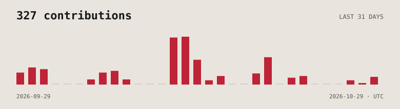

[English](./README.md) · [Polski](./README.pl.md)

# Damian Ułaś

**Buduję aplikacje. Ogarniam agentów.**

Jestem fullstack developerem z Zamościa. Tworzę aplikacje od bazy danych po interfejs w **Next.js, TypeScript i PostgreSQL** oraz narzędzia, które porządkują pracę z agentami programistycznymi. Wyznaczam kierunek, sprawdzam zmiany i odpowiadam za efekt.

[Portfolio ↗](https://damianocode.github.io/) · [LinkedIn ↗](https://www.linkedin.com/in/damian-ulas/) · [Napisz do mnie ↗](mailto:damianulas@gmail.com)

## Wybrane projekty

### [PlaceMates](https://github.com/DamianoCode/PlaceMates)

Wspólna mapa do zapisywania miejsc, oceniania punktów i planowania wyjazdów ze znajomymi. **Next.js · PostgreSQL / PostGIS · Supabase · MapLibre**

[Wypróbuj ↗](https://placemates.pl) · [Kod ↗](https://github.com/DamianoCode/PlaceMates)

### [Claudius](https://github.com/DamianoCode/claudius)

Proces pracy dla Claude Code, który dopasowuje implementację do ryzyka technicznego, z kontraktami i niezależnym przeglądem. **Skille Markdown · Hooki JavaScript · Git worktrees**

[Zobacz, jak działa ↗](https://github.com/DamianoCode/claudius)

### [Claude Widget](https://github.com/DamianoCode/claude-widget)

Widget dla Windows do śledzenia sesji programistycznych, oczekujących zgód, kontekstu i limitów. **C# · .NET · WPF · TypeScript**

[Kod ↗](https://github.com/DamianoCode/claude-widget) · [Pobierz ↗](https://github.com/DamianoCode/claude-widget/releases/latest)

## Z czym pracuję

- **Web:** TypeScript, React, Next.js, Astro, Tailwind CSS.
- **Dane i backend:** PostgreSQL, PostGIS, Supabase, Drizzle, Prisma, Node.js, Zod.
- **Desktop i narzędzia:** C#, .NET, WPF, Git, Claude Code.

## Ostatnia aktywność

<a href="https://github.com/DamianoCode?tab=overview#year-list-container">
  <picture>
    <source media="(prefers-color-scheme: dark)" srcset="./assets/activity-dark.svg" />
    <source media="(prefers-color-scheme: light)" srcset="./assets/activity-light.svg" />
    
  </picture>
</a>

---

Rower, gry, manga i komiksy. Berserk, Daredevil i Ferrari F1 — regularny trening dystansu do życia.

Człowiek w pętli. Czasami poza fotelem.
